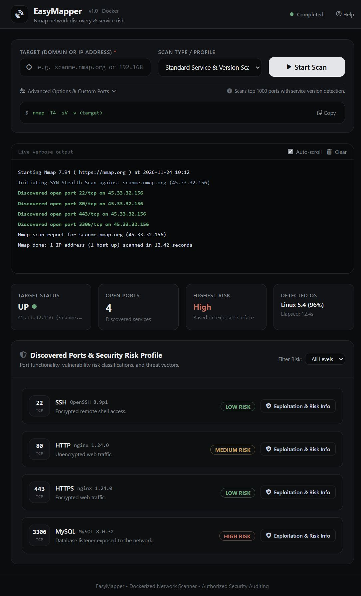

# EasyMapper

EasyMapper is a containerized web interface for Nmap, built for network reconnaissance and security risk review. Scan output streams live, the exact Nmap command is shown as you configure it, and every open port is classified by risk with practical hardening guidance.



---

## Features

- **Live verbose output**: watch Nmap discover ports and run scripts line by line, streamed with Server-Sent Events.
- **Scan profiles**:
  - Quick port scan: top 100 ports (`-T4 -F -v`).
  - Standard service scan: top 1000 ports with version detection (`-T4 -sV -v`).
  - OS and service detection: identifies the target OS and service banners (`-T4 -sV -O -v`).
  - Aggressive scan: OS detection, version scanning, script scanning and traceroute (`-T4 -A -v`).
  - Vulnerability script scan: runs Nmap's vulnerability detection scripts (`--script=vuln`).
  - Full port scan: all 65,535 TCP ports (`-p- -sV -v`).
  - Pingless scan: bypasses host discovery for targets that block ICMP (`-Pn`).
- **Command preview**: shows the exact `nmap` command built from the target, profile and advanced flags.
- **Port purpose and risk ratings**: classifies each open port as Low, Medium, High or Critical and explains its normal role.
- **Threat and hardening notes**: each port has a detail panel listing theoretical attack vectors and practical remediation steps.
- **Input validation**: target and port inputs are validated before execution to prevent command injection.
- **Containerized**: runs on `python:3.11-slim` with Nmap preinstalled.

---

## Quickstart with Docker

### 1. Build the image

```bash
docker build -t easymapper:latest .
```

### 2. Run the container

```bash
docker run -d \
  --name easymapper \
  -p 8000:8000 \
  --cap-add=NET_RAW \
  --cap-add=NET_ADMIN \
  --restart unless-stopped \
  easymapper:latest
```

`--cap-add=NET_RAW --cap-add=NET_ADMIN` grants the container permission to craft raw packets, which Nmap needs for OS fingerprinting (`-O`) and SYN scans.

### 3. Or use Docker Compose

```bash
docker compose up -d
```

### 4. Open the interface

```
http://localhost:8000
```

---

## Project structure

```
easymapper/
├── Dockerfile                  # Container definition with Nmap and Python 3.11
├── docker-compose.yml          # Compose specification with NET_RAW capabilities
├── requirements.txt            # FastAPI, Uvicorn, Jinja2, Pydantic
├── .dockerignore
├── README.md
├── docs/
│   └── easymapper-preview.jpg  # Interface preview used in this README
└── app/
    ├── main.py                 # FastAPI backend, async Nmap runner and SSE streaming
    ├── port_kb.py              # Knowledge base of ports, risks, attack vectors and fixes
    ├── templates/
    │   └── index.html          # Web interface with live console
    └── static/
```

---

## Security and usage notice

EasyMapper is intended strictly for authorized network inventory, defensive security auditing and educational threat modeling. Only scan networks, domains and systems you own or have explicit authorization to assess.
